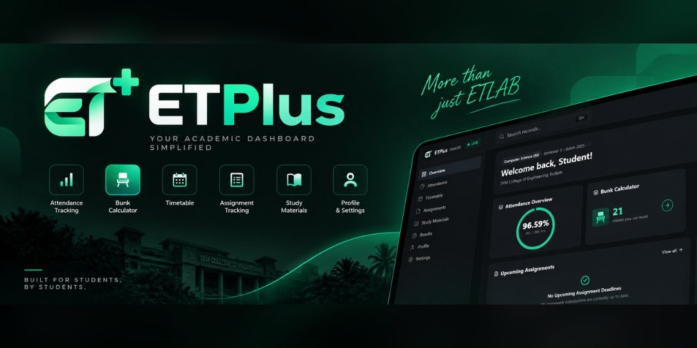

  

# 🎓 ETPlus

**A cleaner, student-friendly interface for ETLAB.**

ETPlus is an independent student dashboard designed to make academic information easier to access, understand, and manage. It brings attendance insights, assignments, results, timetables, and shared study resources into one clean interface.

🌐 **Use ETPlus:** [et-plus.vercel.app](https://et-plus.vercel.app)

## ✨ Features

- 📊 **Attendance** — View attendance percentages and explore projected attendance with a what-if simulator.
- 📅 **Timetable** — Access your class schedule in an organized format.
- 📝 **Assignments** — Track assignment deadlines and submission statuses.
- 📚 **Study Materials** — Share and access previous question papers and study notes.
- 📈 **Results** — View available internal assessments and academic results.
- 🏆 **End-Sem Results** — Check published end-semester marks and grades.
- 📢 **Announcements** — Share and view updates with your student cohort.
- 👤 **Student Profile** — Access your profile and preferences.
- 🌙 **Dark Interface** — A minimal, responsive interface designed for everyday use.

*Feature availability depends on the data available to the authenticated student.*

## 🛠️ Tech Stack

- **Next.js 16** — React framework
- **React 19** — UI library
- **TypeScript** — Type-safe development
- **Tailwind CSS v4** — Styling
- **Recharts** — Charts and data visualization
- **Lucide React** — Icons
- **Cheerio** — HTML parsing

## 🔐 Security & Privacy

ETPlus is designed to handle student-specific academic information responsibly.

- Student data should only be accessible to the authenticated student.
- Authentication and data access must use authorized mechanisms.
- Student sessions and upstream ETLAB sessions must be isolated appropriately.
- Credentials and session tokens must not be exposed in client-side code or committed to version control.
- Official academic records must come from authorized data sources.
- Shared study materials and announcements must follow the application's authentication and ownership rules.
- Attendance projections are informational calculations and must not modify official attendance records.

Never use ETPlus to access another student's private academic information without authorization.

## ⚠️ Disclaimer

ETPlus is an independent, student-focused project. It is **not affiliated with, endorsed by, sponsored by, or an official product of ETLAB or TKM College of Engineering**.

**ETPlus does not claim ownership of ETLAB, its source code, branding, trademarks, or other proprietary materials.** ETLAB is an external academic platform that ETPlus connects to, where authorized, to retrieve the authenticated student's academic information and present it through an alternative interface.

ETLAB remains the source of truth for official academic records. ETPlus is not intended to replace ETLAB or bypass its authentication, access controls, or usage restrictions.

All third-party software, trademarks, institutional content, and assets remain the property of their respective owners. The project's license applies only to original code and other materials that the project maintainer has the legal right to license.

Use ETPlus only with authorized access and in accordance with the applicable platform rules and institutional policies.

## 📄 License

See the [LICENSE file](LICENSE) for the project's licensing terms.

---

Made with 💻 for a better student dashboard experience.
